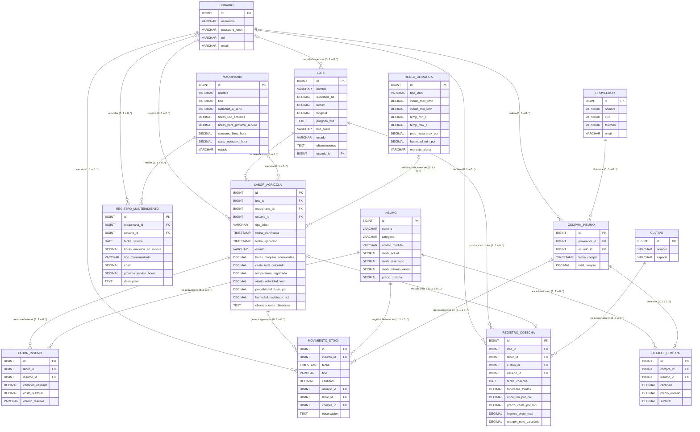

# 2. Diagrama Entidad-Relación (DER)

A continuación se presenta el modelo relacional diseñado para la plataforma. El núcleo del sistema gira en torno a la entidad **`labor_agricola`**, que articula el lote, la maquinaria asignada, los insumos consumidos y las condiciones climáticas validadas. Se han incorporado las entidades de **Usuario**, **Compras** y trazabilidad de **Movimientos de Stock**, así como **Cultivo** como catálogo independiente.

**Notación de cardinalidades en el diagrama (*Crow's Foot*):**
* `||` : exactamente uno (`1..1`, clave foránea obligatoria `NOT NULL`).
* `|o` o `o|` : cero o uno (`0..1`, clave foránea opcional `NULL` o vínculo único opcional).
* `|{` : uno o muchos (`1..*`, al menos un registro hijo obligatorio por regla de negocio).
* `o{` : cero o muchos (`0..*`, colección opcional de registros hijos).

### 2.1. Reserva lógica de stock y control de concurrencia

Para dar soporte al caso de uso **CU-03 (Programar Labor Agrícola)**, el modelo incorpora la **reserva de stock** sin necesidad de una tabla adicional:

* **`insumo.stock_reservado`**: cantidad del insumo comprometida por labores planificadas que todavía no se ejecutaron. El stock que puede asignarse a una nueva labor es el **stock disponible**: `stock_actual - stock_reservado`.
* **`labor_insumo.estado_reserva`**: indica en qué situación se encuentra cada línea de insumo de una labor:
  * `RESERVADO`: la labor está planificada y la cantidad está comprometida (suma en `stock_reservado`).
  * `CONSUMIDO`: la labor se inició, se descontó el stock físico y se registró un `EGRESO_LABOR` en `movimiento_stock`.
  * `LIBERADO`: la labor se canceló y la cantidad volvió a estar disponible.

La reserva no genera registros en `movimiento_stock` porque no altera el stock físico; sólo el consumo real (`EGRESO_LABOR`) queda en el historial de movimientos. Ante operaciones concurrentes (por ejemplo, dos agrónomos programando o iniciando labores simultáneamente sobre el mismo insumo), la consistencia se garantiza mediante **transacciones ACID con bloqueo pesimista a nivel de fila (`SELECT ... FOR UPDATE`) adquirido en orden ascendente de `insumo_id`** y restricciones `CHECK` en base de datos (`chk_insumo_stock` y `chk_insumo_reservado`), detalladas en [07_arquitectura_trazabilidad.md](./07_arquitectura_trazabilidad.md#74-estrategia-de-concurrencia-y-consistencia-transaccional-de-stock).

---

### 2.2. Formalización de Campaña Agrícola / Ciclo Productivo y Política de Cosechas

En el dominio agropecuario, un lote atraviesa sucesivos ciclos productivos a lo largo del tiempo (por ejemplo, un cultivo de invierno/primavera como `Trigo` seguido por uno de verano/otoño como `Soja 2°`, o una nueva campaña anual de `Maíz Tardío`).

**Decisión de modelado:** se adopta una **delimitación implícita de Ciclo Productivo basada en estados del lote (`lote.estado`) e hitos de cosecha (`registro_cosecha.fecha_cosecha`)**, prescindiendo de una tabla `campana` independiente. Esta decisión mantiene el esquema normalizado y evita rigideces artificiales cuando distintos lotes inician o cierran sus cultivos en fechas diferentes o realizan doble cultivo anual (*cultivos de primera y de segunda*, ya tipificados en el catálogo `cultivo`).

El modelo gestiona formalmente los períodos productivos y las cosechas bajo las siguientes reglas (`RN-12` en [06_reglas_negocio_casos_uso.md](./06_reglas_negocio_casos_uso.md#61-reglas-de-negocio-rn)):

1. **Definición de Ciclo Productivo de un Lote:**
   * Un ciclo productivo de un lote comprende el período que transcurre desde el inicio de su preparación (`EN_PREPARACION` → `SEMBRADO` → `EN_CRECIMIENTO` → `LISTO_COSECHA`) hasta el registro de su cosecha (`COSECHADO`), o bien hasta el reinicio a `EN_PREPARACION` por pérdida climática total documentada.
   * **Ventana temporal de imputación de costos:** para un lote dado, el ciclo productivo $k$ queda delimitado por el intervalo $(F_{k-1},\; F_k]$, donde $F_{k-1}$ es la `fecha_cosecha` del `registro_cosecha` inmediato anterior de ese lote (o el origen histórico del lote si $k = 1$) y $F_k$ es la `fecha_cosecha` del cierre actual. Todas las labores agrícolas con `estado = 'COMPLETADA'` cuya `fecha_ejecucion` pertenece a ese intervalo se imputan a dicho ciclo. Si el lote se encuentra aún en un ciclo abierto (sin cosecha posterior a sus últimas labores), sus labores completadas desde $F_{k-1}$ conforman el **costo acumulado del ciclo en curso**.

2. **Política de Cosechas (Cosecha consolidada por ciclo, sin cosechas parciales abiertas):**
   * Cada fila de `registro_cosecha` representa el **resultado productivo y comercial consolidado del cierre de un ciclo productivo** en ese lote (`RN-02`: exige que el lote esté en `LISTO_COSECHA` y al registrarse transiciona el lote automáticamente a `COSECHADO`).
   * **No se registran cosechas parciales independientes dentro de un mismo ciclo:** si la trilla física en el campo demanda más de una jornada operativa, se consolida el total de toneladas recolectadas (`toneladas_totales`) y el precio de comercialización pactado (`precio_venta_por_ton`) en un único `registro_cosecha` al concluir la recolección del lote, vinculándolo opcionalmente (`0..1`) a la orden de trabajo de tipo `COSECHA` mediante `labor_id UNIQUE`.

3. **Soporte de Múltiples Campañas Consecutivas y Análisis Histórico (`Lote 1 ── 0..* RegistroCosecha`):**
   * La relación `LOTE (1) ── (0..*) REGISTRO_COSECHA` permite que un mismo lote acumule su historial completo a través de **múltiples campañas sucesivas**.
   * Una vez cerrado un ciclo (`COSECHADO`), cuando el agrónomo inicia la campaña siguiente pasando el lote nuevamente a `EN_PREPARACION` (doc 06 §6.3.1), el registro de la cosecha anterior permanece inalterable con su `ingreso_bruto_total`, `rinde_ton_por_ha` y `margen_neto_calculado` persistidos históricamente (`RN-05`), permitiendo análisis comparativos entre campañas (`EXTRACT(YEAR FROM fecha_cosecha)`), lotes y cultivos (`cultivo_id`).
